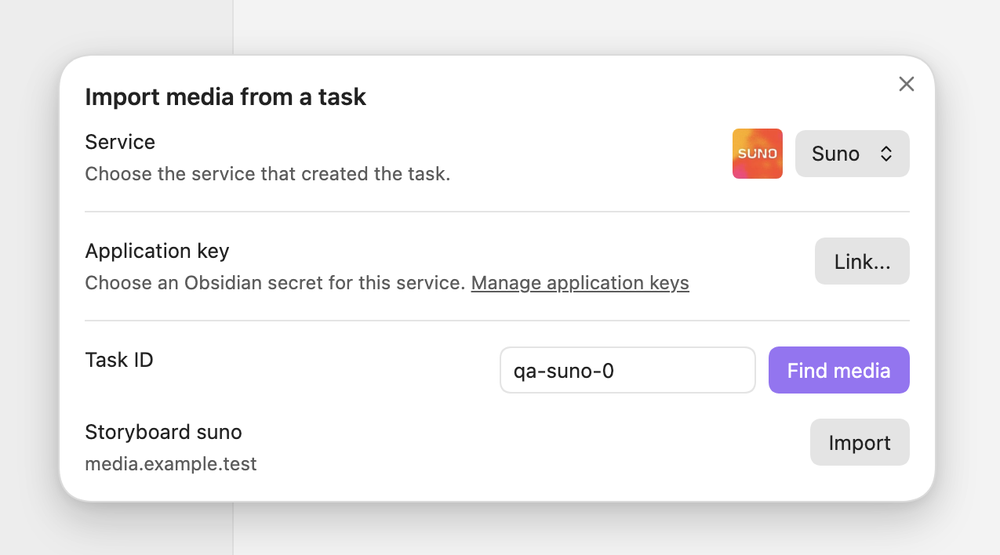

# Ace Media Attachments

Bring finished artwork, music, and video from an Ace Data Cloud task into a Markdown note. Choose one result, save it in the vault’s configured attachment folder, and embed it at the cursor. The downloaded file remains available when the note is offline.

## Import an attachment

1. Open a Markdown note in editing mode and place the cursor where you want the attachment.
2. Open the command palette and select **Ace Media Attachments: Import media from a task**.
3. Choose the service that created the task. Use **Application key** to select or create an Obsidian keychain secret with access to that service. Each service can use its own key. [Manage application keys](https://platform.acedata.cloud/console/applications?utm_source=opensource&utm_medium=referral&utm_campaign=evergreen)
4. Paste the existing task ID and choose **Find media**. If the task is still processing, repeat the lookup once it finishes.
5. Choose **Import** beside a result. The hostname shown in that row is where the file will be downloaded from. Imports support files up to 64 MiB each.

| Media | Supported services |
| --- | --- |
| Audio | Suno, ACE Music |
| Image | Nano Banana, GPT Image, Seedream, Flux |
| Video | Seedance, Kling, Veo, Hailuo |

## Account, costs, and network use

An Ace Data Cloud account, an application key for the selected service, and an existing task are required. Creating the original media can incur charges. This plugin only retrieves a task and downloads a result you select. [Service pricing](https://platform.acedata.cloud/models?utm_source=opensource&utm_medium=referral&utm_campaign=evergreen)

A lookup sends the selected service, task ID, and application key to `api.acedata.cloud`. Importing a selected result performs a separate HTTPS download from the media host without the application key. Note text, note paths, and vault contents are never uploaded. The plugin saves the selected service and the names of keychain secrets in its settings. It uses no client-side analytics. [Ace Data Cloud privacy policy](https://docs.acedata.cloud/en/resources/privacy?utm_source=opensource&utm_medium=referral&utm_campaign=evergreen)

## Install from a release

Requires Obsidian 1.11.4 or newer. From the [latest release](https://github.com/AceDataCloud/ObsidianMediaNotes/releases/latest), place `manifest.json`, `main.js`, and `styles.css` together in `.obsidian/plugins/ace-media-notes/` inside your vault. Enable **Ace Media Attachments** in **Settings → Community plugins**. BRAT users can add `AceDataCloud/ObsidianMediaNotes` as a beta plugin.

## Development

Use Node.js 22.14 or newer. Run `npm ci`, `npm test`, and `npm run build`. The build bundles the ten service images directly into `main.js` so the picker also works offline. Service artwork comes from the [Ace Data Cloud media integration](https://github.com/AceDataCloud/NodeREDAceMusic/tree/main/media/resources).
